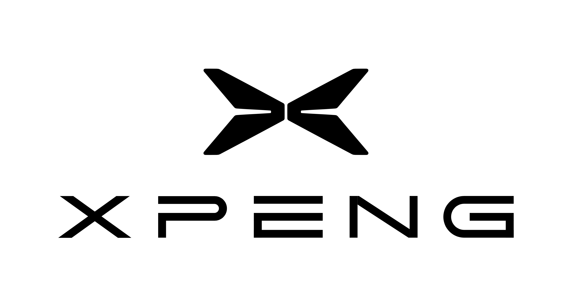

# 2027 New Grad & AI Jobs

<!-- CATALOG:START -->

**Your next opportunity might have a job title you've never searched for.**

Explore US new-grad opportunities across software engineering, AI, research, data and infrastructure.

We go beyond job titles to highlight employer requirements, eligibility, compensation and direct application links.

**14 jobs · 11 companies · United States**

[AI](indexes/functions.md#ai) · [Research](indexes/functions.md#research) · [Software](indexes/functions.md#swe) · [FDE](indexes/functions.md#fde) · [Infrastructure](indexes/functions.md#infrastructure) · [Data](indexes/functions.md#data)

## Companies

###  Astera Labs

| Role | Location | Workplace | Pay (USD) | Eligibility | Verified | Apply |
| --- | --- | --- | --- | --- | --- | --- |
| **Applied AI NCG** | San Jose, CA | On-site | $140k–$155k | Recent / upcoming bachelor or master graduates | 2026-11-26 | [Apply](https://job-boards.greenhouse.io/asteraearlycareer2027/jobs/4731594005) |

###  Atoms

| Role | Location | Workplace | Pay (USD) | Eligibility | Verified | Apply |
| --- | --- | --- | --- | --- | --- | --- |
| **AI Researcher - New Grad (BS/MS)** | San Francisco, CA | On-site | $170k–$170k | Recent graduate or completing Bachelor’s or Master’s in CS, EECS, Robotics, AI, or related | 2026-11-26 | [Apply](https://job-boards.greenhouse.io/atoms/jobs/8948841002) |
| **AI Researcher - New Grad (PhD)** | San Francisco, CA | On-site | $190k–$190k | PhD in CS, EECS, Robotics, AI, or related (completed or expected this academic year) | 2026-11-26 | [Apply](https://job-boards.greenhouse.io/atoms/jobs/8924635002) |

###  Authentic

| Role | Location | Workplace | Pay (USD) | Eligibility | Verified | Apply |
| --- | --- | --- | --- | --- | --- | --- |
| **New Grad Software Engineer** | New York, NY | See posting | $130k–$145k | Recent or Fall 2026 / Spring 2027 graduates | 2026-11-26 | [Apply](https://job-boards.greenhouse.io/authenticinsurance/jobs/4114318009) |

###  Chalk

| Role | Location | Workplace | Pay (USD) | Eligibility | Verified | Apply |
| --- | --- | --- | --- | --- | --- | --- |
| **Forward Deployed Engineer - New Grad** | San Francisco / New York | On-site | $170k–$180k | Spring 2027; professional backend engineering experience; Python, SQL, bachelor's degree | 2026-11-26 | [Apply](https://jobs.ashbyhq.com/chalk/927c74a5-1b40-490d-b3be-a29baec4db6f) |

###  Further

| Role | Location | Workplace | Pay (USD) | Eligibility | Verified | Apply |
| --- | --- | --- | --- | --- | --- | --- |
| **Graduate Program: Entry Level Analytics Developer 2027** | Cleveland, OH | Hybrid | $65k–$68k | Bachelor completed Fall 2026–Spring 2027; no sponsorship | 2026-11-26 | [Apply](https://job-boards.greenhouse.io/furtherearlycareer/jobs/8932692002) |
| **Graduate Program: Entry Level Developer 2027** | Dallas, TX | Hybrid | $68k–$70k | Bachelor completed Fall 2026–Spring 2027; no sponsorship | 2026-11-26 | [Apply](https://job-boards.greenhouse.io/furtherearlycareer/jobs/8906198002) |

###  OpenAI

| Role | Location | Workplace | Pay (USD) | Eligibility | Verified | Apply |
| --- | --- | --- | --- | --- | --- | --- |
| **Software Engineer, Applied Emerging Talent (2027)** | San Francisco, CA | Hybrid | $180k–$180k | Bachelor's or Master's in CS/CE/relevant field (or equivalent); 0–1 years software engi… | 2026-11-26 | [Apply](https://jobs.ashbyhq.com/openai/55150071-fce8-48f5-aea4-14ed78b83511) |

###  Pylon

| Role | Location | Workplace | Pay (USD) | Eligibility | Verified | Apply |
| --- | --- | --- | --- | --- | --- | --- |
| **Software Engineer, New Grad** | San Francisco, CA | On-site | $150k–$180k | Bachelor's/master's related field; start summer 2027; internship OR relevant side projects | 2026-11-26 | [Apply](https://jobs.ashbyhq.com/pylon-labs/38814ce7-217b-40f2-9ba5-8a7733a5691d) |

###  Sierra

| Role | Location | Workplace | Pay (USD) | Eligibility | Verified | Apply |
| --- | --- | --- | --- | --- | --- | --- |
| **APX (New Grad 2027)** | San Francisco, CA | On-site | Not disclosed | Undergraduate or Master’s graduating by June 2027 | 2026-11-26 | [Apply](https://jobs.ashbyhq.com/Sierra/d9c445da-c7b4-43a3-8d71-d367681c3015) |
| **Software Engineer, Agent (New Grad 2027)** | San Francisco / New York | On-site | $150k–$180k | New Grad 2027; job values end-to-end systems and customer experience | 2026-11-26 | [Apply](https://jobs.ashbyhq.com/Sierra/149f368c-52d5-408f-ba26-ad888f318a00) |

###  SpaceX

| Role | Location | Workplace | Pay (USD) | Eligibility | Verified | Apply |
| --- | --- | --- | --- | --- | --- | --- |
| **New Graduate Engineer, Software ('26/'27)** | Palo Alto, CA | On-site | $135k–$210k | Class of 2026 or 2027; export-control conditions may apply | 2026-11-26 | [Apply](https://job-boards.greenhouse.io/spacex/jobs/8696080002) |

###  Whatnot

| Role | Location | Workplace | Pay (USD) | Eligibility | Verified | Apply |
| --- | --- | --- | --- | --- | --- | --- |
| **Software Engineer, 2027 New Grad** | NY / LA / SF / Seattle | Hybrid | $155k–$160k | Graduated CS / Software Engineering by summer 2027 | 2026-11-26 | [Apply](https://jobs.ashbyhq.com/whatnot/29bad846-de60-4be7-a222-69b97e044930) |

###  XPENG

| Role | Location | Workplace | Pay (USD) | Eligibility | Verified | Apply |
| --- | --- | --- | --- | --- | --- | --- |
| **Software Engineer, Computing Platform (New Graduate)** | Santa Clara, CA | On-site | $124k–$210k | 2026/27 graduate; refer to posting | 2026-11-26 | [Apply](https://job-boards.greenhouse.io/xpengmotors/jobs/8962912002) |

---

Last verified **2026-11-26**. Recheck employer postings before applying. Source: [`data/jobs.json`](data/jobs.json), [`data/companies.json`](data/companies.json). Indexes: [functions](indexes/functions.md) · [companies](indexes/companies.md) · [pay](indexes/salary.md) · [recent](indexes/recent.md). Contribute via [Issues](https://github.com/ziek-ai/2027-New-Grad-and-AI-Jobs/issues) / [CONTRIBUTING.md](CONTRIBUTING.md).

<!-- CATALOG:END -->
