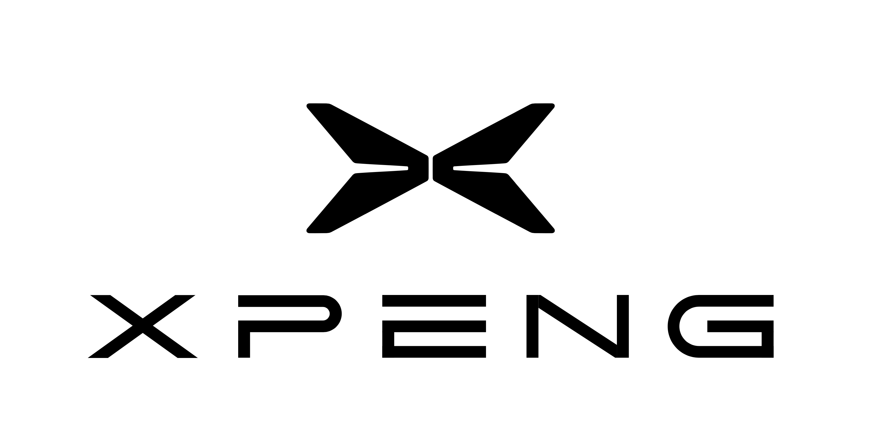

# Recently added and verified

## Recently added

| Logo | Company | Role | Pay | Apply |
| --- | --- | --- | --- | --- |
|  | [OpenAI](../README.md#company-openai) | [Software Engineer, Applied Emerging Talent (2027)](https://jobs.ashbyhq.com/openai/55150071-fce8-48f5-aea4-14ed78b83511) | $180k–$180k | [Employer](https://jobs.ashbyhq.com/openai/55150071-fce8-48f5-aea4-14ed78b83511) |
|  | [Atoms](../README.md#company-atoms) | [AI Researcher - New Grad (BS/MS)](https://job-boards.greenhouse.io/atoms/jobs/8948841002) | $170k–$170k | [Employer](https://job-boards.greenhouse.io/atoms/jobs/8948841002) |
|  | [Atoms](../README.md#company-atoms) | [AI Researcher - New Grad (PhD)](https://job-boards.greenhouse.io/atoms/jobs/8924635002) | $190k–$190k | [Employer](https://job-boards.greenhouse.io/atoms/jobs/8924635002) |
|  | [Sierra](../README.md#company-sierra) | [APX (New Grad 2027)](https://jobs.ashbyhq.com/Sierra/d9c445da-c7b4-43a3-8d71-d367681c3015) | Not disclosed | [Employer](https://jobs.ashbyhq.com/Sierra/d9c445da-c7b4-43a3-8d71-d367681c3015) |
|  | [Astera Labs](../README.md#company-astera-labs) | [Applied AI NCG](https://job-boards.greenhouse.io/asteraearlycareer2027/jobs/4731594005) | $140k–$155k | [Employer](https://job-boards.greenhouse.io/asteraearlycareer2027/jobs/4731594005) |
|  | [Authentic](../README.md#company-authentic) | [New Grad Software Engineer](https://job-boards.greenhouse.io/authenticinsurance/jobs/4114318009) | $130k–$145k | [Employer](https://job-boards.greenhouse.io/authenticinsurance/jobs/4114318009) |
|  | [XPENG](../README.md#company-xpeng) | [Software Engineer, Computing Platform (New Graduate)](https://job-boards.greenhouse.io/xpengmotors/jobs/8962912002) | $124k–$210k | [Employer](https://job-boards.greenhouse.io/xpengmotors/jobs/8962912002) |
|  | [SpaceX](../README.md#company-spacex) | [New Graduate Engineer, Software ('26/'27)](https://job-boards.greenhouse.io/spacex/jobs/8696080002) | $135k–$210k | [Employer](https://job-boards.greenhouse.io/spacex/jobs/8696080002) |
|  | [Further](../README.md#company-further) | [Graduate Program: Entry Level Developer 2027](https://job-boards.greenhouse.io/furtherearlycareer/jobs/8906198002) | $68k–$70k | [Employer](https://job-boards.greenhouse.io/furtherearlycareer/jobs/8906198002) |
|  | [Further](../README.md#company-further) | [Graduate Program: Entry Level Analytics Developer 2027](https://job-boards.greenhouse.io/furtherearlycareer/jobs/8932692002) | $65k–$68k | [Employer](https://job-boards.greenhouse.io/furtherearlycareer/jobs/8932692002) |
|  | [Whatnot](../README.md#company-whatnot) | [Software Engineer, 2027 New Grad](https://jobs.ashbyhq.com/whatnot/29bad846-de60-4be7-a222-69b97e044930) | $155k–$160k | [Employer](https://jobs.ashbyhq.com/whatnot/29bad846-de60-4be7-a222-69b97e044930) |
|  | [Pylon](../README.md#company-pylon) | [Software Engineer, New Grad](https://jobs.ashbyhq.com/pylon-labs/38814ce7-217b-40f2-9ba5-8a7733a5691d) | $150k–$180k | [Employer](https://jobs.ashbyhq.com/pylon-labs/38814ce7-217b-40f2-9ba5-8a7733a5691d) |
|  | [Sierra](../README.md#company-sierra) | [Software Engineer, Agent (New Grad 2027)](https://jobs.ashbyhq.com/Sierra/149f368c-52d5-408f-ba26-ad888f318a00) | $150k–$180k | [Employer](https://jobs.ashbyhq.com/Sierra/149f368c-52d5-408f-ba26-ad888f318a00) |
|  | [Chalk](../README.md#company-chalk) | [Forward Deployed Engineer - New Grad](https://jobs.ashbyhq.com/chalk/927c74a5-1b40-490d-b3be-a29baec4db6f) | $170k–$180k | [Employer](https://jobs.ashbyhq.com/chalk/927c74a5-1b40-490d-b3be-a29baec4db6f) |

## Recently verified

| Logo | Company | Role | Pay | Apply |
| --- | --- | --- | --- | --- |
|  | [OpenAI](../README.md#company-openai) | [Software Engineer, Applied Emerging Talent (2027)](https://jobs.ashbyhq.com/openai/55150071-fce8-48f5-aea4-14ed78b83511) | $180k–$180k | [Employer](https://jobs.ashbyhq.com/openai/55150071-fce8-48f5-aea4-14ed78b83511) |
|  | [Astera Labs](../README.md#company-astera-labs) | [Applied AI NCG](https://job-boards.greenhouse.io/asteraearlycareer2027/jobs/4731594005) | $140k–$155k | [Employer](https://job-boards.greenhouse.io/asteraearlycareer2027/jobs/4731594005) |
|  | [Authentic](../README.md#company-authentic) | [New Grad Software Engineer](https://job-boards.greenhouse.io/authenticinsurance/jobs/4114318009) | $130k–$145k | [Employer](https://job-boards.greenhouse.io/authenticinsurance/jobs/4114318009) |
|  | [XPENG](../README.md#company-xpeng) | [Software Engineer, Computing Platform (New Graduate)](https://job-boards.greenhouse.io/xpengmotors/jobs/8962912002) | $124k–$210k | [Employer](https://job-boards.greenhouse.io/xpengmotors/jobs/8962912002) |
|  | [SpaceX](../README.md#company-spacex) | [New Graduate Engineer, Software ('26/'27)](https://job-boards.greenhouse.io/spacex/jobs/8696080002) | $135k–$210k | [Employer](https://job-boards.greenhouse.io/spacex/jobs/8696080002) |
|  | [Further](../README.md#company-further) | [Graduate Program: Entry Level Developer 2027](https://job-boards.greenhouse.io/furtherearlycareer/jobs/8906198002) | $68k–$70k | [Employer](https://job-boards.greenhouse.io/furtherearlycareer/jobs/8906198002) |
|  | [Further](../README.md#company-further) | [Graduate Program: Entry Level Analytics Developer 2027](https://job-boards.greenhouse.io/furtherearlycareer/jobs/8932692002) | $65k–$68k | [Employer](https://job-boards.greenhouse.io/furtherearlycareer/jobs/8932692002) |
|  | [Whatnot](../README.md#company-whatnot) | [Software Engineer, 2027 New Grad](https://jobs.ashbyhq.com/whatnot/29bad846-de60-4be7-a222-69b97e044930) | $155k–$160k | [Employer](https://jobs.ashbyhq.com/whatnot/29bad846-de60-4be7-a222-69b97e044930) |
|  | [Pylon](../README.md#company-pylon) | [Software Engineer, New Grad](https://jobs.ashbyhq.com/pylon-labs/38814ce7-217b-40f2-9ba5-8a7733a5691d) | $150k–$180k | [Employer](https://jobs.ashbyhq.com/pylon-labs/38814ce7-217b-40f2-9ba5-8a7733a5691d) |
|  | [Sierra](../README.md#company-sierra) | [Software Engineer, Agent (New Grad 2027)](https://jobs.ashbyhq.com/Sierra/149f368c-52d5-408f-ba26-ad888f318a00) | $150k–$180k | [Employer](https://jobs.ashbyhq.com/Sierra/149f368c-52d5-408f-ba26-ad888f318a00) |
|  | [Chalk](../README.md#company-chalk) | [Forward Deployed Engineer - New Grad](https://jobs.ashbyhq.com/chalk/927c74a5-1b40-490d-b3be-a29baec4db6f) | $170k–$180k | [Employer](https://jobs.ashbyhq.com/chalk/927c74a5-1b40-490d-b3be-a29baec4db6f) |
|  | [Atoms](../README.md#company-atoms) | [AI Researcher - New Grad (BS/MS)](https://job-boards.greenhouse.io/atoms/jobs/8948841002) | $170k–$170k | [Employer](https://job-boards.greenhouse.io/atoms/jobs/8948841002) |
|  | [Atoms](../README.md#company-atoms) | [AI Researcher - New Grad (PhD)](https://job-boards.greenhouse.io/atoms/jobs/8924635002) | $190k–$190k | [Employer](https://job-boards.greenhouse.io/atoms/jobs/8924635002) |
|  | [Sierra](../README.md#company-sierra) | [APX (New Grad 2027)](https://jobs.ashbyhq.com/Sierra/d9c445da-c7b4-43a3-8d71-d367681c3015) | Not disclosed | [Employer](https://jobs.ashbyhq.com/Sierra/d9c445da-c7b4-43a3-8d71-d367681c3015) |
